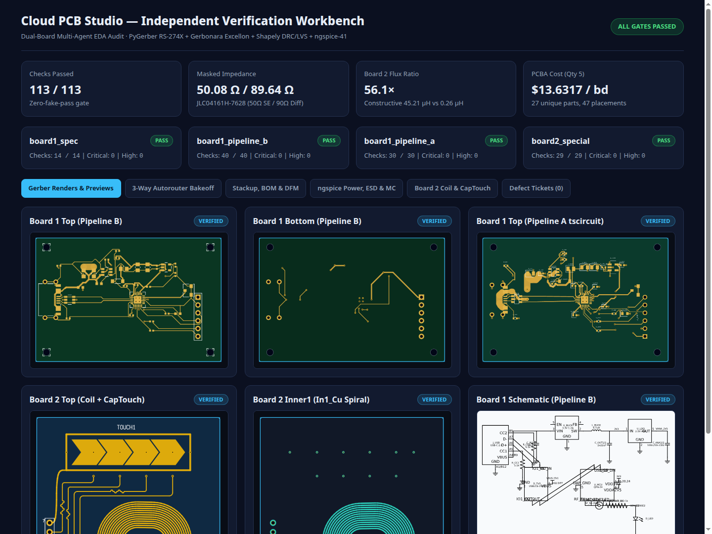
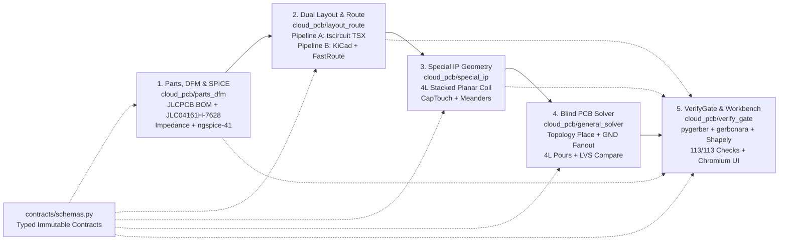
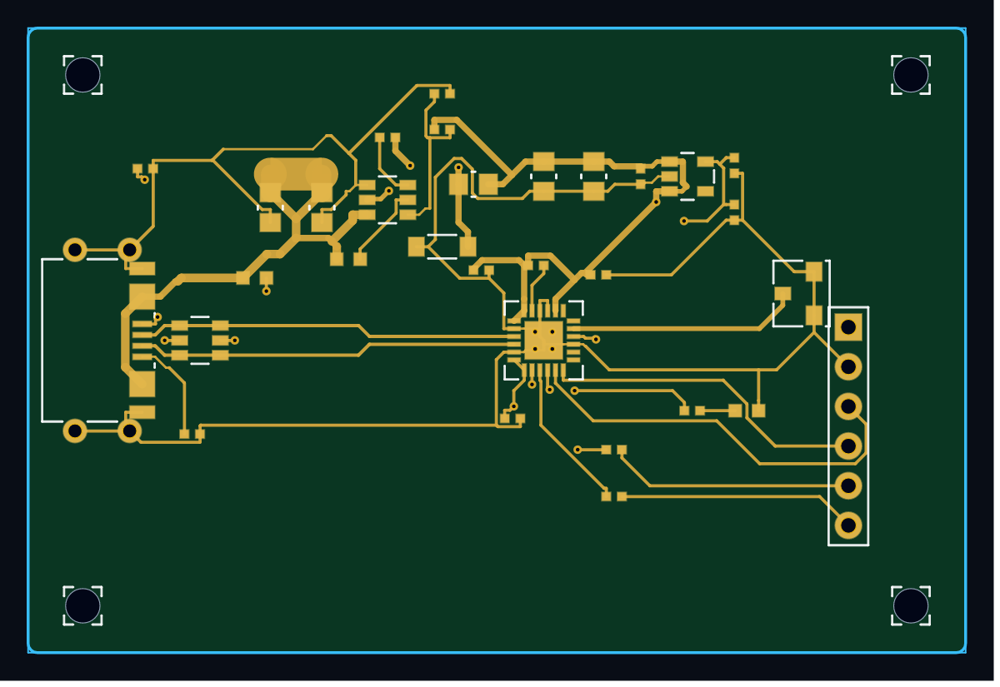
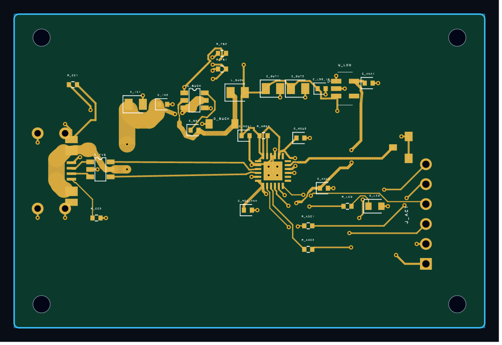
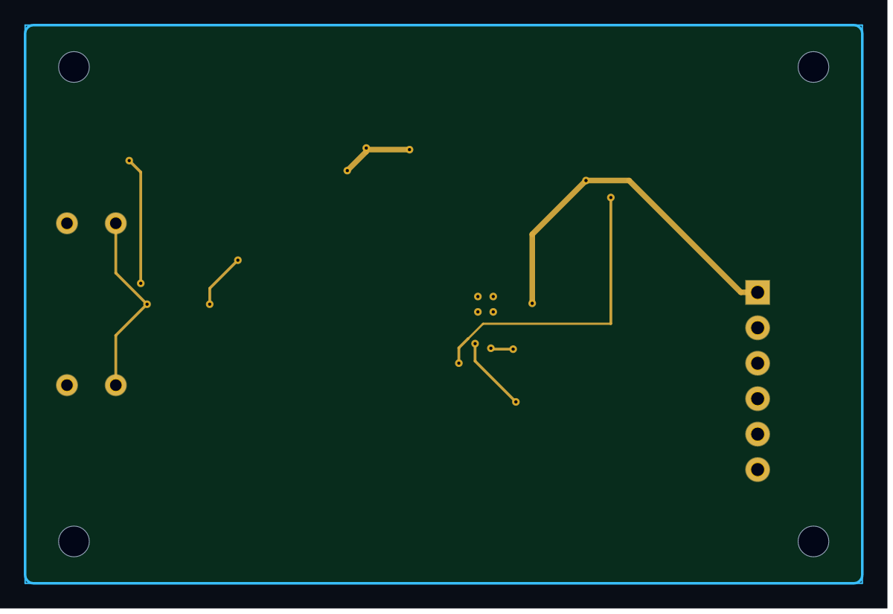
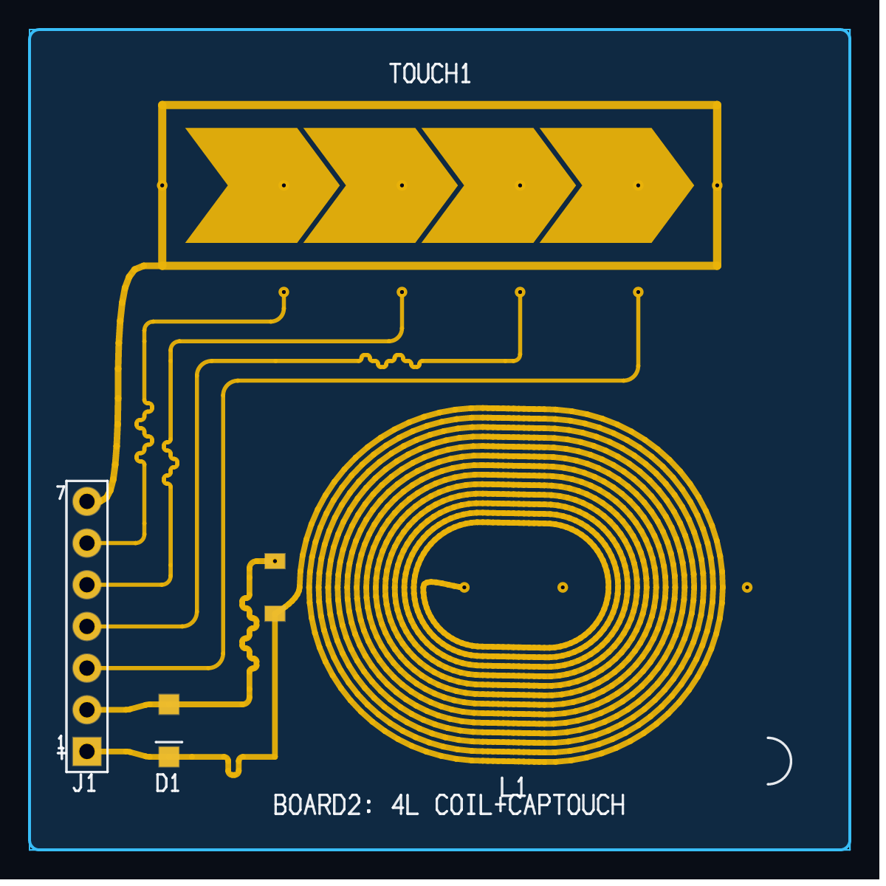
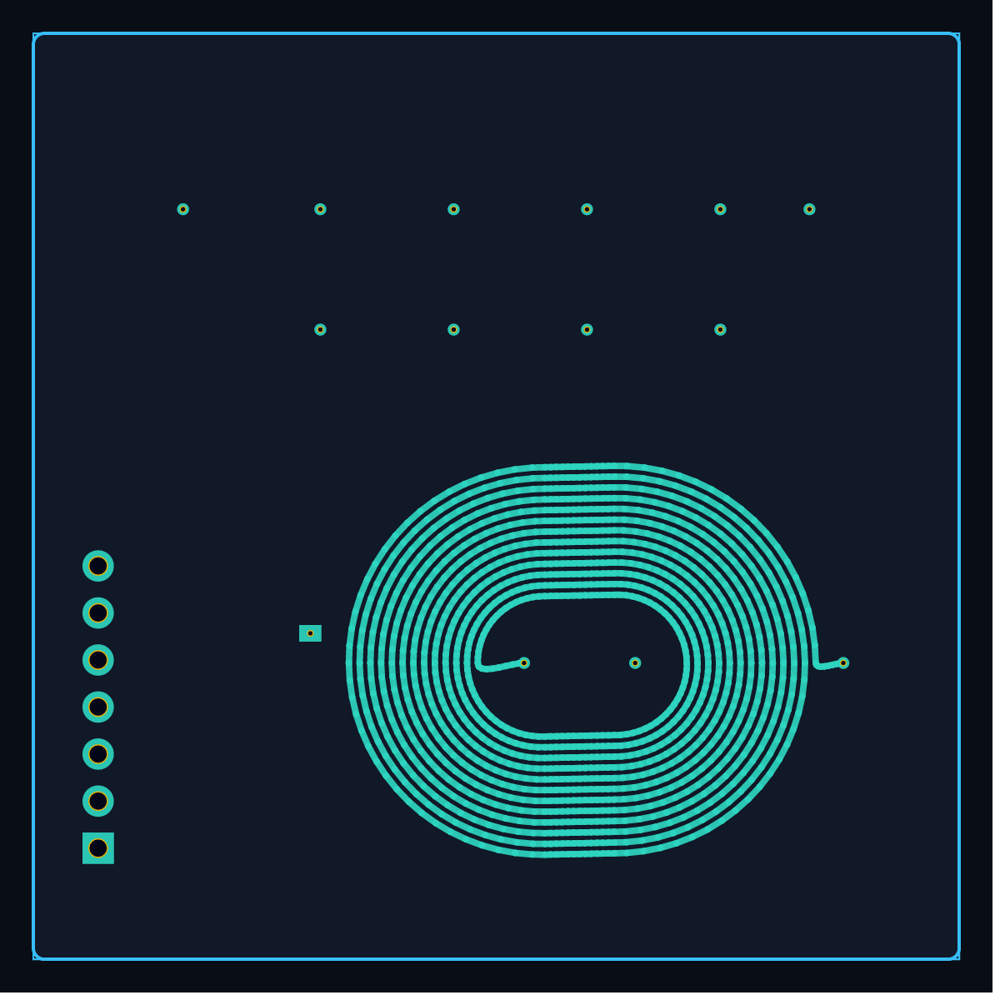
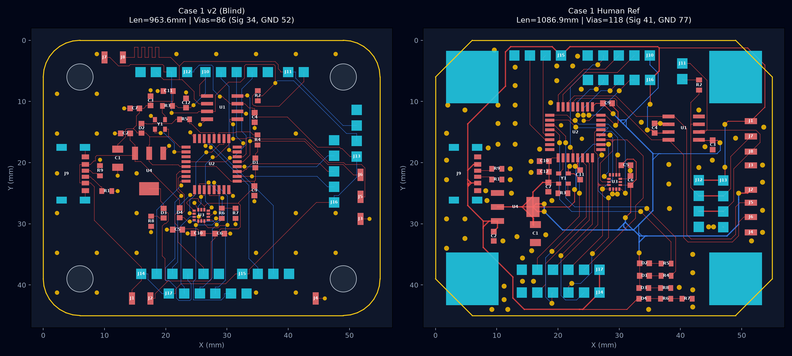
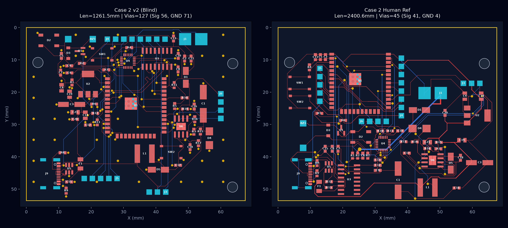
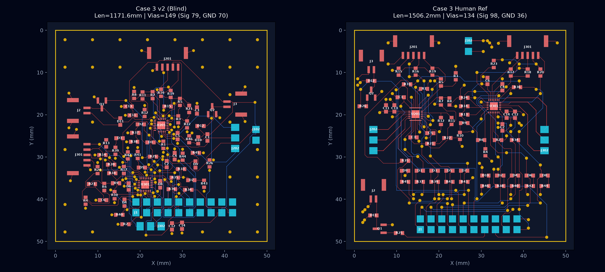

> **Current handoff — 2026-11-17:** the repository now includes the v3 solver, five-board frozen artifacts, 3D previews and optimization history. Latest recorded tests: **123 passed in 73.42 s**. The latest candidate was **not promoted**; remaining electrical, RF and mechanical failures are documented. Start with [the handoff guide](docs/repository-handoff.zh-CN.md) and [the measured round](docs/optimization-octagonal-fanout.zh-CN.md). Historical showcase sections retain the earlier v2/workbench measurements.

<div align="center">

# Cloud PCB Studio

**Headless Cloud Multi-Agent EDA Workbench & Board-Agnostic Blind PCB Solver**

[](#quick-setup--reproducible-runs)
[](#architecture--5-stage-eda-pipeline)
[](#verified-quantitative-results)
[](#3-way-autorouter-bake-off-board-1)
[](#verifygate-113--113-checks-passed--0-critical--0-high)
[](#zero-fake-pass-verification-policy)

*From JLCPCB BOM & SPICE physics to dual-pipeline autorouting, 4-layer planar magnetics, board-agnostic blind layout, and strict RS-274X / Excellon / Shapely LVS sign-off — 100% headless on Linux.*

> **中文概要** — **Cloud PCB Studio** 是一个全无头（Headless）云端多智能体 EDA 工程工作台与板级盲解（Blind）自动布局布线系统：覆盖 **器件选型/DFM 物理与 `ngspice-41` 仿真**、**双路布局布线（`@tscircuit/core` 与 KiCad/`fastroute` 竞速）**、**4 层同向磁通平面螺旋线圈与电容触摸专用 IP**、**零过拟合通用盲解引擎（在 3 块真实开源 PCB 上对比人工参考线长缩短 11.3%–47.5%）**，以及 **113/113 项严格零造假 VerifyGate 几何与拓扑 LVS 验收闭环**。

<br/>



*Independent Verification Workbench (`artifacts/verify/workbench.html`) — rendered & audited via headless Chromium (`1440×1080`, `0` console errors, `113 / 113` checks passed).*

</div>

## Current v3 solver and reproducible handoff

Use **Python 3.12** for the measured environment and load `source scripts/env.sh` before every Python, pytest or router invocation. A fresh clone needs its own virtual environment, Node dependencies, Playwright Chromium and ngspice. See [setup and current limitations](docs/repository-handoff.zh-CN.md). Runtime credentials and local dependency/cache directories are not distributed through Git.

Use the optimization workflow for new work. It preserves the frozen v3
artifacts and records each experiment in its own directory:

```bash
source scripts/env.sh
python -m scripts.optimize_pcb status
source scripts/env.sh
python -m scripts.optimize_pcb run --label my-change --hypothesis "Describe the generic change and expected improvement"
source scripts/env.sh
python -m scripts.optimize_pcb history
```

Open `artifacts/blind_v3_caseN/assembly.html` directly in a browser; it contains
its own Three.js code and model geometry. Parametric package envelopes and
estimated heights are identified in `assembly_scene.json`; zero envelope
collisions alone does not certify unknown real mechanical dimensions.
See [the research and implementation limits](docs/v3-design-decisions.zh-CN.md).

The workflow runs pytest, all regression boards, strict audits and offline
browser checks before comparing each board against the baseline. A regression
on one board cannot be hidden by gains on another. An eligible experiment only
updates an artifact baseline pointer; it does not certify engineering quality.
Unsealed cases 4 and 5 are regression data. Sealed holdouts are excluded from
optimization. See [the Chinese optimization guide](docs/optimization-workflow.zh-CN.md).
The [first measured round](docs/optimization-first-round.zh-CN.md) records both
the connectivity improvement and the regression that prevented promotion.

The experimental `--variant supply-semantics` enables supply inference from
hierarchical voltage labels and typed power pins. It keeps evidence in
`effective_spec.json` and never invents missing current ratings. The default
solver remains on the stable behavior while the candidate is evaluated.

The `--variant scoped-supply` experiment distinguishes a single IC supply
domain, evidenced by typed supply pins, shunt return capacitors and passive
R/L/C endpoints, from board-level distribution. Unknown-current local domains
have an independent routing intent; backbone and explicit current/width
requirements retain priority. Scope and width provenance remain in the output.

For the user-selected independent Gemini reference, use
`scripts.run_gemini_reference` with model `gemini-4-hydrogen` and a runtime
credential. It sends anonymous blind input and records API provenance; it does
not treat a generated placement proposal as a routed or verified reference.
See [the external-reference protocol](docs/gemini-reference.zh-CN.md).

`scripts/run_blind_v3.py` is retained as the historical experiment entry point;
it writes the fixed v3 directories. Use `scripts.optimize_pcb` for daily work
so existing frozen results remain available for comparison.


---

## Why Cloud PCB Studio?

Most automated PCB demos stop at toy footprints or skip electrical, thermal, and manufacturing validation. **Cloud PCB Studio** treats PCB synthesis as a deterministic, physics-gated engineering pipeline where every stage emits typed contracts ([`contracts/schemas.py`](contracts/schemas.py)) and must survive independent geometric, electromagnetic, and circuit-level verification:

- **Physics Before Routing**: Rejects thermally fatal LDO traps (`197.2 °C` and `6212.8 °C` counterfactuals vs. `81.45 °C` synchronous buck), models trapezoidal copper etch + solder-mask dielectric loading (`-7.07 Ω` SE / `-15.33 Ω` Diff drop on `JLC04161H-7628`), checks MLCC DC-bias derating across all 18 capacitors, and verifies `ngspice-41` transient, Monte Carlo, and ESD clamp currents (`102.9×` reduction) before a trace is drawn.
- **Dual Synthesis + Real Autorouter Bake-Off**: Compiles Board 1 (`60 × 40 mm` USB-C PD Telemetry & Actuator Node) through both a code-first TSX pipeline (`@tscircuit/core` + `@tscircuit/capacity-autorouter`) and a programmatic KiCad/Specctra DSN/SES pipeline (`fastroute v0.1.14` vs. `freerouting-cli v2.5.0`).
- **Electromagnetic & Curved-Geometry Special IP**: Synthesizes Board 2 (`50 × 50 mm`) with a 4-layer stacked racetrack haptic coil whose alternating winding chirality (`+1, -1, +1, -1`) yields **`56.06×`** constructive axial flux (`45.209 µH` vs. `0.264 µH` canceling counterfactual), paired with a chevron CapTouch slider and `0.0 mm`-error serpentine meanders.
- **Board-Agnostic Blind Solver (`general_solver`)**: Consumes *only* an abstract `blind_spec.json` (never touching sealed human reference `.kicad_pcb` files) to place components, assign decoupling caps by capacitance & pin budget, insert pre-route SMD GND fanout vias, route via Specctra DSN/SES bake-off, pour 4-layer GND zones with stitching vias, and verify full 3D LVS/DRC.
- **Zero-Fake-Pass Gatekeeper (`verify_gate`)**: Strictly parses RS-274X Gerbers with `pygerber` (never patching malformed files on disk), Excellon drills exclusively with `gerbonara`, runs Shapely 3D topological LVS + via-in-pad checks, renders composite copper/mask/silk/drill PNGs via `resvg_py`, and audits the generated dashboard in headless Chromium.

---

## Architecture & 5-Stage EDA Pipeline



| Stage | Package / Entrypoint | Core Engine & Libraries | Key Verified Outputs |
| :--- | :--- | :--- | :--- |
| **1. Parts & DFM** | [`cloud_pcb/parts_dfm/`](cloud_pcb/parts_dfm/cli.py) | `PySpice`, `ngspice-41`, JLCPCB Basic/Preferred CSV + `jlcsearch` cache | [`artifacts/spec/`](artifacts/spec/dfm_budget.json) (`bom_verified.json`, `dfm_budget.json`, `spice_*.json`) |
| **2. Dual Layout & Route** | [`cloud_pcb/layout_route/`](cloud_pcb/layout_route/board1_kicad_fastroute.py) | `@tscircuit/core`, `esbuild`, `kiutils`, `fastroute v0.1.14`, `freerouting-cli v2.5.0`, `gerbonara`, `schemdraw` | [`artifacts/board1_tscircuit/`](artifacts/board1_tscircuit/tscircuit_report.json) & [`artifacts/board1_kicad_fastroute/`](artifacts/board1_kicad_fastroute/router_bakeoff.json) |
| **3. Special IP** | [`cloud_pcb/special_ip/`](cloud_pcb/special_ip/export_special_board.py) | Biot–Savart coil solver, Chaikin/arc fillets, serpentine meanders, `ngspice-41`, `pygerber` | [`artifacts/board2_special/`](artifacts/board2_special/board_manifest.json) (`special_board.kicad_pcb`, `coil_params.json`, Gerbers) |
| **4. General Blind Solver** | [`cloud_pcb/general_solver/`](cloud_pcb/general_solver/run_blind.py) | Netlist clustering, capacity-aware bypass matching, GND fanout vias, 4L pours, `compare_reference.py` | [`artifacts/blind_benchmark_v2/`](artifacts/blind_benchmark_v2/comparison_report.json), [`blind_case2/`](artifacts/blind_case2/comparison_report.json), [`blind_case3/`](artifacts/blind_case3/comparison_report.json) |
| **5. VerifyGate & UI** | [`cloud_pcb/verify_gate/`](cloud_pcb/verify_gate/__main__.py) & [`workbench_ui/`](cloud_pcb/workbench_ui/generate_workbench.py) | `pygerber`, `gerbonara`, `shapely`, `resvg_py`, headless Chromium | [`artifacts/verify/gate_report.json`](artifacts/verify/gate_report.json) & [`workbench.html`](artifacts/verify/workbench.html) |

---

## Visual Showcase

### Board 1 — USB-C PD Telemetry & Smart Actuator Node (`60 × 40 mm`, 4-Layer `JLC04161H-7628`)

Composite Gerber + Excellon renders generated by [`cloud_pcb/verify_gate/visual_inspect.py`](cloud_pcb/verify_gate/visual_inspect.py) using `pygerber`, `gerbonara`, and `resvg_py`:

| Pipeline B Top (`KiCad + FastRoute v0.1.14`) | Pipeline A Top (`@tscircuit/core`) | Pipeline B Bottom (`B_Cu + PTH/NPTH`) |
| :---: | :---: | :---: |
|  |  |  |
| `0` USB-path vias, `2.1 mm` VBUS trunk, `4` QFN thermal vias | `0` tscircuit errors, `64` vias, `440.46 mm` wirelength | `0` annular ring violations (`0.125 mm` min), `4` NPTH mounts |

### Board 2 — Special IP: 4-Layer Constructive Coil & Chevron CapTouch Slider (`50 × 50 mm`, 4-Layer)

| Top Layer (`F_Cu + F_Mask + F_SilkS + PTH`) | Inner Layer 1 (`In1_Cu` Counter-Wound Spiral) |
| :---: | :---: |
|  |  |
| 4 chevron electrodes (`0.3 mm` gap), GND guard ring, `0.0 mm`-error meanders, `SS33` flyback clamp | Polarity-inverted (`-1`) spiral maintaining CW current flow for `56.06×` axial flux addition |

### Blind Solver (`general_solver`) vs. Human Reference — 3 Real Open-Source Boards

Each comparison below pits the **board-agnostic blind solver** (left, consuming only `blind_spec.json`) against the **original human-designed open-source KiCad PCB** (right):

#### Case 1: STM32 CAN + IMU Sensor Board (`can_sensor_board_hw`, `55.0 × 45.0 mm`, 36 nets)


#### Case 2: ESP32-WROOM-32E Flight Controller (`esp32_flight_controller_rev2`, `67.5 × 53.5 mm`, 50 nets)


#### Case 3: Dual MCT8314ZH BLDC Motor Driver (`sima_bldc_motor_driver`, `50.0 × 50.0 mm`, 56 nets)


---

## Verified Quantitative Results

All numbers below are extracted directly from the checked-in verification artifacts on disk (`artifacts/verify/gate_report.json`, `artifacts/spec/*.json`, `artifacts/board1_kicad_fastroute/router_bakeoff.json`, `artifacts/board2_special/*.json`, and `artifacts/blind_*/comparison_report.json`).

### VerifyGate (`113 / 113` Checks Passed · `0` Critical / `0` High)

| Audit Suite | Checks Passed | Critical / High | Verified Highlights |
| :--- | :---: | :---: | :--- |
| **`board1_spec`** | `14 / 14` | `0 / 0` | `JLC04161H-7628` masked impedance **`50.08 Ω`** SE / **`89.64 Ω`** Diff; `47` BOM placements (`0` low-stock parts); Buck `Tj = 81.45 °C`, LDO `Tj = 49.93 °C`; `ngspice-41` transient, MC (`1593.79 Hz`), ESD clamp (`1.603 mA`) |
| **`board1_pipeline_b`** | `40 / 40` | `0 / 0` | `pygerber` & `gerbonara` clean RS-274X/Excellon; `0` LVS opens/shorts; `0` via-in-pad collisions; `0.1517 mm` min inter-net clearance; `0.0 mm²` silk-to-mask overlap; `0` USB path vias; `2.1 mm` VBUS width; `4` QFN thermal vias |
| **`board1_pipeline_a`** | `30 / 30` | `0 / 0` | `0` tscircuit errors; `2.4331 mm` USB-C-to-TVS stub; `0` USB path vias; `2.1 mm` VBUS width; distinct CC1/CC2 nets; `0` LVS opens/shorts; `0.1007 mm` min clearance; `0.125 mm` min annular ring |
| **`board2_special`** | `29 / 29` | `0 / 0` | **`56.06×`** constructive coil flux (`4042.89` vs `72.12 µT/A`); `45.209 µH` vs `0.264 µH`; **`0.33%`** SPICE $\tau$ error; `3.5985 V` Schottky clamp; `0` LVS shorts; `0.5065 mm` min clearance; `2.65 mm` copper-to-edge margin |
| **Headless Chromium** | `PASS` | `0` errors | `workbench.html` (`1,045,708` DOM chars), `1440×1080` screenshot (`pixel_std = 63.96`), all 5 PyGerber composite renders verified non-blank |
| **Total** | **`113 / 113`** | **`0 / 0`** | **`overall_passed = true` · `defect_tickets = []`** |

<details>
<summary><strong>Stage 1 Physics, JLCPCB BOM & ngspice-41 Verification Metrics</strong></summary>

| Domain | Metric | Measured Result | Engineering Target / Notes |
| :--- | :--- | :--- | :--- |
| **Stackup & Impedance** | `JLC04161H-7628` 4L (`ENIG`) SE `50 Ω` | **`50.08 Ω`** masked (`57.15 Ω` bare) | `12.06 mil` drawn (`11.665 mil` trapezoid eff.); `-7.07 Ω` mask drop |
| **Stackup & Impedance** | `JLC04161H-7628` 4L (`ENIG`) Diff `90 Ω` | **`89.64 Ω`** masked (`104.96 Ω` bare) | `8.31 mil` W / `5.0 mil` S (`-15.33 Ω` mask drop) |
| **JLCPCB BOM (Qty 5)** | PCBA cost per board | **`$13.63 / bd`** (`$13.6317/bd`) | `$68.16` total PCBA (`$7.824/bd` components), `47` placements (`27` unique, `181` joints) |
| **JLCPCB Supply Chain** | Basic / Preferred & stock health | **`87.2%`** Basic/Preferred · **`100%` stock > 100** | `17` Basic + `4` Preferred + `6` Extended; lowest stock = `408` (`STM32G0B1CEU6`); dual `5.1 kΩ` (`R1`, `R2`) |
| **Thermal Crossover** | Buck `3.3 V @ 1.2 A` vs. LDO traps | **`81.45 °C` PASS** (`TPS54202HDDCR`) | LDO `20V->3.3V @ 1.2A` (`6212.8 °C`) & `5V->3.3V @ 0.3A` (`197.2 °C`) rejected; `2.5V` LDO `49.93 °C` PASS |
| **ngspice-41 Power** | `20 V -> 3.3 V` Buck + `2.5 V` LDO | **`3.2981 V`** (`18.054 mVpp`) / **`2.4984 V`** (`0.0062 mVpp`) | `0.4 -> 1.2 A` step: `172.77 mV` Buck undershoot, `0.1026 mV` LDO max deviation |
| **ngspice-41 Monte Carlo** | 30-run RC filter (`1 kΩ ±1%`, `100 nF ±10%`) | **`1593.79 Hz`** mean (`0.0014%` nominal err) | `0` imaginary-frequency anomalies; capacitor accounts for `99.5%` of $f_c$ variance |
| **ngspice-41 ESD Clamp** | `USBLC6-2SC6` + `1 kΩ` limiter vs. `1 Ω` | **`164.91 mA -> 1.603 mA`** (**`102.9×`** reduction) | Peak IC pin voltage clamped `5.354 V -> 3.916 V`; well below `20 mA` latchup threshold |
| **Board 2 EM & SPICE** | 4L stacked coil (`51` turns, `2732.8 mm`) | **`56.06×` flux** · **`45.209 vs 0.264 µH`** · **`0.33%` $\tau$ err** | `4042.89` vs `72.12 µT/A`; $\tau_{\text{sim}} = 7.6558\,\mu\text{s}$ vs $7.681\,\mu\text{s}$; `SS33` clamped `3.5985 V` |

</details>

### 3-Way Autorouter Bake-Off (Board 1)

| Autorouter Engine | Status | Routed Nets | Unrouted | Vias | Wirelength | Runtime | Engineering Notes |
| :--- | :---: | :---: | :---: | :---: | :---: | :---: | :--- |
| **`fastroute v0.1.14`** *(Winner)* | **PASS** | **`23 / 23`** | **`0`** | `16` *(route SES)* | `564.99 mm` | `10,351.5 ms` | `0` violations, `0` USB path vias; selected for final Pipeline B Gerbers (`20` KiCad vias incl. 4 QFN thermal) |
| **`freerouting-cli v2.5.0`** | **FAIL** | `22 / 23` | `6` | `12` | `507.01 mm` | `3,951.9 ms` | `0` USB path vias; capped at `max_passes=1` (v2.5.0 GraalVM `BoardSnapshotManager` crashes when `max_passes > 1`) |
| **`tscircuit_capacity_autorouter`** | **PASS** | **`24 / 24`** | **`0`** | `64` | **`440.46 mm`** | *(Node bundle)* | `0` errors, `0` USB path vias; powers code-first Pipeline A (`board1.tsx`) |

### Board-Agnostic Blind Solver (`general_solver`) vs. Human Reference

Evaluated strictly zero-overfitting (`blind_spec.json` only) against three real open-source KiCad projects:

| Benchmark Board | Size & Nets | Wirelength (Blind vs. Human) | Length Delta | Routed Nets | Vias (Blind vs. Human) | LVS Opens / Shorts (Blind) | Key Highlights & Honest Audit Notes |
| :--- | :---: | :---: | :---: | :---: | :---: | :---: | :--- |
| **Case 1: [`can_sensor_board_hw`](https://github.com/HardyYu/can_sensor_board_hw)** | `55.0 × 45.0 mm` · `36` nets | **`963.6 mm`** vs. `1086.9 mm` | **`-11.3%`** | **`36 / 36`** | `86` (`34` Sig / `52` GND) vs. `118` (`41` / `77`) | **`0 / 0`** | `CAN_H`/`CAN_L` mismatch `3.012 mm` vs. `8.684 mm` (Human); `86.8%` 4L GND pour; `0.1317 mm` min clearance |
| **Case 2: [`esp32_flight_controller_rev2`](https://github.com/shazmeenShz/ESP32-Flight-Controller)** | `67.5 × 53.5 mm` · `50` nets | **`1261.5 mm`** vs. `2400.6 mm` | **`-47.5%`** | **`50 / 50`** | `127` (`56` Sig / `71` GND) vs. `45` (`41` / `4`) | **`0 / 0`** | Both USB diff pairs matched to **`0.100 mm`** skew (vs. `33.79 mm` / `1.07 mm` Human); `91.75%` 4L GND pour; `4.82 mm` avg header edge dist (vs. `18.19 mm`) |
| **Case 3: [`sima_bldc_motor_driver`](https://github.com/lio-tam/Autonomous-SIMA-Robot)** | `50.0 × 50.0 mm` · `56` nets | **`1171.6 mm`** vs. `1506.2 mm` | **`-22.2%`** | **`55 / 56`** | `149` (`79` Sig / `70` GND) vs. `134` (`98` / `36`) | **`1 / 0`** | **1 unrouted LVS open** on `/M2_BRAKE` (2 islands, 3 pads); **`0` shorts** (`0.1317 mm` min clr). *(Note: unedited Human Ref exhibits `12` `F.Cu` LVS shorts / `0.0 mm` min clr)* |

---

## Quick Setup & Reproducible Runs

### 1. Provision Cloud EDA Toolchain (`scripts/setup_cloud_eda.sh`)

[`scripts/setup_cloud_eda.sh`](scripts/setup_cloud_eda.sh) bootstraps the entire headless toolchain in user space (`.venv`, `.mamba/ngspice`, `node_modules`, `bin/{fastroute,freerouting-cli}`, and `data/` JLCPCB caches):

```bash
bash scripts/setup_cloud_eda.sh
source scripts/env.sh
```

> **Note**: Sourcing [`scripts/env.sh`](scripts/env.sh) puts `.venv/bin`, `bin/`, `.mamba/ngspice/bin`, and `node_modules/.bin` onto `PATH` while keeping tool caches inside `.run/`. Pre-built Linux x64 binaries for `fastroute` (`v0.1.14`) and `freerouting-cli` (`v2.5.0`) are already included under [`bin/`](bin/).

### 2. Run Individual Pipelines & Blind Benchmarks

```bash
source scripts/env.sh

# Stage 1: JLCPCB BOM selection, DFM stackup/impedance, and ngspice-41 power/ESD/MC sims
python -m cloud_pcb.parts_dfm --qty 5 --mc-runs 30

# Stage 2A & 2B: Board 1 code-first tscircuit + KiCad/FastRoute 3-way bake-off
python -m cloud_pcb.layout_route.board1_tscircuit
python -m cloud_pcb.layout_route.board1_kicad_fastroute

# Stage 3: Board 2 Special IP (4L stacked coil, chevron CapTouch, meanders, ngspice)
python -m cloud_pcb.special_ip.export_special_board --out artifacts/board2_special

# Stage 4: Board-agnostic blind solver + quantitative side-by-side comparison (Case 1 / 2 / 3)
python -m cloud_pcb.general_solver.run_blind \
  --spec benchmark_case/blind_spec.json \
  --outdir artifacts/blind_benchmark_v2

python -m cloud_pcb.general_solver.compare_reference \
  --blind artifacts/blind_benchmark_v2/routed.kicad_pcb \
  --ref benchmark_case/sealed_reference/can_sensor_board_kicad/Sensor_Board.kicad_pcb \
  --spec benchmark_case/blind_spec.json \
  --out-json artifacts/blind_benchmark_v2/comparison_report.json \
  --out-png artifacts/blind_benchmark_v2/comparison_side_by_side.png

# Case 2 (ESP32 Flight Controller) & Case 3 (Dual BLDC Driver)
python -m cloud_pcb.general_solver.run_blind \
  --spec benchmark_case/blind_spec_case2.json \
  --outdir artifacts/blind_case2

python -m cloud_pcb.general_solver.run_blind \
  --spec benchmark_case/blind_spec_case3.json \
  --outdir artifacts/blind_case3

# Stage 5: Independent Zero-Fake-Pass VerifyGate (strict mode exits non-zero on CRITICAL/HIGH tickets)
python -m cloud_pcb.verify_gate --strict
```

### 3. Run the Test Suite (`26` Unit & Integration Tests)

```bash
source scripts/env.sh
python -m pytest -v
```

<details>
<summary><strong>Zero-Fake-Pass Verification Policy & Negative Tests</strong></summary>

[`tests/test_verify_gate.py`](tests/test_verify_gate.py) includes adversarial fault-injection tests confirming that [`cloud_pcb/verify_gate`](cloud_pcb/verify_gate/gerber_drc.py) refuses to silently pass broken outputs:
- Rejects malformed RS-274X syntax (`G75` missing `*` terminator) via strict `pygerber` parsing.
- Rejects low-stock BOM parts (`stock <= 100`), negative/non-finite Monte Carlo corner frequencies (`-1.8e199` / `NaN`), and ESD pin clamp currents `>= 20 mA`.
- Rejects Board 2 coil $\tau$ step errors `>= 2.0%` or constructive flux ratios `<= 10×`.
- Isolates Excellon drill parsing strictly to `gerbonara.excellon.ExcellonFile` and verifies copper-to-edge margins, annular rings, via-in-non-thermal-SMT-pad collisions, and multi-layer LVS connectivity.

</details>

---

## Repository Structure

```text
cloud-pcb-studio/
├── bin/                        # Pre-built fastroute (v0.1.14) & freerouting-cli (v2.5.0) binaries
├── contracts/
│   └── schemas.py              # Typed dataclasses (StackupProfile, SelectedPart, GateReport, VerifyTicket)
├── cloud_pcb/
│   ├── parts_dfm/              # Stage 1: JLCPCB catalog, DFM physics, ngspice-41 simulations
│   ├── layout_route/           # Stage 2: board1.tsx (tscircuit) & board1_kicad_fastroute.py (DSN/SES)
│   ├── special_ip/             # Stage 3: 4L planar coil, chevron CapTouch, Chaikin & meander routing
│   ├── general_solver/         # Stage 4: board-agnostic blind solver & reference comparison tool
│   ├── verify_gate/            # Stage 5: pygerber/gerbonara/Shapely LVS/DRC & Chromium visual inspector
│   └── workbench_ui/           # Standalone interactive HTML verification dashboard generator
├── benchmark_case/             # Blind specs (Cases 1–3) & sealed open-source KiCad human references
├── artifacts/                  # Generated specs, KiCad PCBs, Gerbers, renders, workbench & comparison PNGs
├── data/                       # Cached JLCPCB Basic/Preferred CSV & jlcsearch snapshots
├── scripts/                    # setup_cloud_eda.sh & env.sh headless environment wrappers
└── tests/                      # 26 pytest unit, physics, adversarial fault-injection, and integration tests
```
