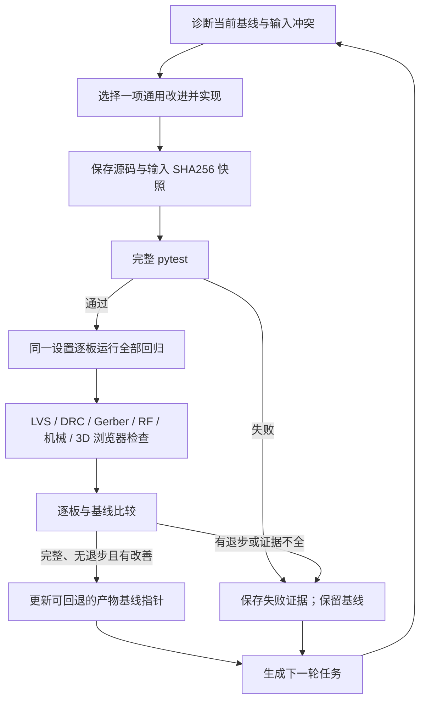

# PCB 持续优化流程

日常迭代使用 `scripts.optimize_pcb`。历史 v3 板、Gerber、报告和密封实验记录保留原样；每轮新结果写入单独目录，不能覆盖历史结果来制造进步。

本流程自动完成验证、记录、诊断和基线判定。算法修改由开发者或接手的智能体提出并实现，每轮必须填写具体改进假设。它不会循环重跑相同源码来挑选偶然较好的分数，也不会根据参考板自动生成工程专属补丁。

## 每轮怎么做



先看诊断：

```bash
source scripts/env.sh
python -m scripts.optimize_pcb status
```

输出 `artifacts/optimization/status/result.json`、`review.md`、离线 `review.html`。任务带稳定证据 ID、优先级和类型：算法问题、输入冲突、验证问题或缺少机械/电气数据。机械接口与板边规则冲突会明确列出实际距离，不会静默移动接口或豁免铜。

实现一个改动后，运行完整轮次：

```bash
source scripts/env.sh
python -m scripts.optimize_pcb run \
  --label my-generic-change \
  --variant placement-recovery \
  --hypothesis '说明改动依据、预期改善指标和适用条件'
```

当前回归产物使用 `placement-recovery`。命令省略 `--variant` 时使用原有的 `stable`。首个电源语义实验可单独复现：

```bash
source scripts/env.sh
python -m scripts.optimize_pcb run \
  --label supply-semantics \
  --variant supply-semantics \
  --hypothesis '依据层级电压标签和有类型的供电脚补齐电源规则，不推定未知载流能力'
```

每块板统一应用同一变体。推导依据只来自盲规范的电压标签、引脚类型/功能和明确电气需求。显式需求优先；参考、开关和接地引脚不因 `power_in` 类型就被加粗；显式高速/差分约束也不会被隐式电源推导覆盖。源 JSON 不改写，实际消费的规范和逐项依据保存在每板 `effective_spec.json`、`electrical_derivations` 中。未知电流仍为未知。

第二个实验变体进一步区分局部供电域和板级分发骨干：

```bash
source scripts/env.sh
python -m scripts.optimize_pcb run \
  --label scoped-supply \
  --variant scoped-supply \
  --hypothesis '单一有类型 IC 供电端、回流电容与 R/L/C 端点共同证明局部供电域；保留骨干和明确电气需求'
```

只对新推导的供电网络细分范围：网表端点与焊盘必须一致，只有一个有供电脚证据的 IC，必须有接回流网络的电容，其他端点只能是可辨识的 R/L/C。有外部接口、第二个 IC、未知器件、缺少回流或端点不一致时仍按分发骨干处理。自定义封装可使用明确的工程单位值佐证 R/L/C 身份，裸数字不作为充分证据。

未知电流的局部域采用独立的默认 0.25 mm 布线意图；骨干默认至少 0.50 mm，明确电流与最小线宽要求始终优先。制造最小线宽、间距、孔环、VIP 和全部门禁不变。该意图不是载流认证：局部域可能包括滤波电感和反馈电阻，拓扑范围也不等于布局已紧凑。范围证据保存在派生规范，逐网目标宽度和电流验证状态见 `power_routing_intent`。稳定默认和第一个实验变体仍保留，不能按案例切换变体。

查看历史：

```bash
source scripts/env.sh
python -m scripts.optimize_pcb history
```

历史命令输出每轮路径、假设、状态和比较结果。最新轮次的固定入口是 `artifacts/optimization/last_run.json`，其中有目录和 manifest 哈希；该目录下的 `review.html` 可直接离线打开，并按案例筛选下一步任务。查看当前基线用 `status`，查看最近一次被拒绝的候选则用 `last_run.json`；两者有意保留为不同记录。

## 什么条件才更新基线

基线指针只指向完整保存的产物，不改源码默认值、不提交代码、不部署项目。指针记录在 `artifacts/optimization/state.json`，每次更新保留之前和之后的指针，原基线文件从不覆盖。

晋升同时要求：

1. 全部已注册回归案例覆盖；pytest 返回成功。
2. 每板都有完整、相互一致的审计证据和通过的离线浏览器检查。
3. 逐板未布通、独立开短路、真实间距、Via-in-Pad、全部 11 层 Gerber、孔环、双面丝印、板边铜距、RF 和机械证据均不退步。过去通过的门禁不得变失败。
4. 电容距离代理值、地填充不足量等已比较质量指标也不退步。线长仅在前后两板均完整布通且 LVS 无开短路时比较。
5. 至少有一项实际改善。指标相同不能凭“又跑了一轮”晋升。

不存在总平均分抵消单板失败的通道。当前策略是较严格的逐板 Pareto 判定：如果一个改动需要质量取舍，它会被保留为未晋升候选，并列出取舍，不能擅自放宽已有门禁。

`eligible_for_baseline` 表示迭代基线资格。`hard_gates_passed` 只表示已有硬门禁。工程验收保留为 **未认证**：本流程不能凭网级长度代理值证明端到端 SI，不能凭默认宽度证明未知电流的 PI/温升，也不能替代独立人工参考线长比较和厂家外壳尺寸。即使一轮比上一轮好，也不意味着已经达到 8–8.5 成目标。

## 过程完整性

- 注册表 `benchmark_case/optimization_suite.json` 固定数据集、输入哈希 和历史基线哈希。Case 1–5、10–11 共七块板用于回归。Case 10–11 完成整组冻结和人工参考对比后加入，沿用解封前产物作为基线。Case 6–9 保持密封。
- `sealed_holdout` 必须带密封元数据。已解封案例不能被改标签冒充 holdout；未解封案例不能进入日常优化的训练/回归运行。流程只读取密封状态元数据，不打开参考 PCB，也不自动解封。新泛化实验仍须走独立密封、代码冻结、完整产物冻结和解封比较流程。
- 每轮保存源码、测试、工具、依赖锁文件和注册表的哈希与 `source.tar.gz`；输入复制到该轮 `inputs/`，与原规范哈希一致。
- 每个阶段前后检查源码及输入。途中改代码或输入会使轮次失效，禁止晋升；候选进程失败、超时或 3D 出错均记录为失败。
- 测试失败就不启动全量路由。子进程有超时及进程组清理。外层执行锁防止两个优化轮次同时修改基线状态。
- 同一源码、同一输入、同一变体和预算的完整轮次不能再次执行。改变 label 或假设文字不构成新实验；这减少重复消耗与择优报喜。
- 全部 Python/pytest/求解器子进程先通过 `source scripts/env.sh`；没有跳过 DRC 或放松门禁的快捷模式。

## 每轮目录

```text
artifacts/optimization/runs/<UTC时间>-<label>/
  source.tar.gz          源码及依赖/配置快照
  inputs/                消费的原始盲规范副本
  pytest.log             完整 pytest -v 输出
  case*/
    solver.log           实际求解进程输出
    effective_spec.json  派生后的消费规范（原文件不变）
    routed.kicad_pcb
    gerbers/
    blind_run_report.json
    assembly.html        自包含交互预览
    assembly_*.png
    assembly_browser_report.json
    metrics.json
  result.json            逐板指标、退步、改善、下一步任务
  review.md
  review.html
  manifest.json          输入/源码/逐板产物/证据哈希与最终状态
```

只筛选某些回归板时可用 `--cases case3,case4`，但这种轮次不能晋升基线。`--case-timeout` 是每板求解进程的外层超时，默认 900 秒，不改变引擎内部的规则或逐案例路由预算。失败输入/失败板也必须保留，不通过换板绕过。

## 后续优化顺序

先解决真实短路、间距与开路，再推进去耦和拥塞协同布局、完整多通道模板、差分端到端路径测量与耦合验证，随后补齐电流/热约束和有依据的厂家外壳尺寸。固定接口与制造门槛的冲突应作为输入工程变更处理，不能伪装成算法已修复。

每轮任务来自真实报告；按任务类别选通用改动，补独立测试，完整运行上述流程，再依据证据决定是否保留。这就是持续优化的工作单元。

状态 `complete` 和进程退出码 0 表示本轮完整执行，不表示候选达标或应晋升。自动化消费者必须读取 `decision.eligible_for_baseline`、`decision.regressions`、`decision.invalid` 和 `last_run.json` 的 `promoted`；不能仅凭退出码或绿色测试把 PCB 判为合格。

## 过孔保护几何实验与路由器日志

`octagonal-fanout` 变体把预布 GND 过孔的方形 DSN 保护区替换为保守外切八边形。它保留原保护圆、原层覆盖和全部实际铜几何，仅释放方形四角；不是缩减制造间距。实现、连续几何验证及实测结果见 [实验记录](optimization-octagonal-fanout.zh-CN.md)。本变体尚未获晋升资格，默认稳定行为仍使用旧方案。

```bash
source scripts/env.sh
python -m scripts.optimize_pcb run \
  --label octagonal-fanout \
  --variant octagonal-fanout \
  --hypothesis '保留原保护半径与层覆盖，以外切八边形释放方角，验证细间距逃线改善且逐板不退步'
```

每板目录新增 `fastroute_primary.log`、适用时的 `fastroute_individual.log`、`freerouting.log`，以及 `router_processes.json`。日志保留原 stdout/stderr；超时也保留已输出内容，退出码记为 null，并明确标注超时。路由器本身的线程异常、进程超时与板级 DRC/LVS 失败应分别判断。不能把崩溃引擎的未完成输出当作一次有效路由结果；同时也不能以次要比较引擎崩溃否认主引擎已有的板级审计证据。
